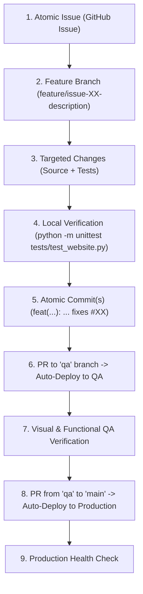

# AGENTS.md — AI Agent Guidance & Operating Manual

> **Single Source of Truth for Autonomous Agents & LLM Contributors**
> **Repository:** [TairiJ/myty-hosting](https://github.com/TairiJ/myty-hosting)
> **Environments:** Production ([myty.world](https://myty.world)) · QA ([qa.myty.world](https://qa.myty.world))

---

## 1. Mission & Overview

You are an AI programming assistant working on **MYTY World**, a containerized multi-environment web ecosystem deployed to a dedicated DigitalOcean Droplet using Traefik, Docker, and GitHub Actions CI/CD.

This project was built under strict Agile development principles:
- **Atomic Issues:** Every change begins with an isolated, single-purpose issue with clear acceptance criteria.
- **Atomic Commits:** Every commit implements a single logical change, conforms to Conventional Commits, and links directly to its issue.
- **Single Source of Truth:** All project context, operational procedures, and architectural decisions are documented in Markdown files within this repository.
- **Strict Environment Isolation:** Changes are verified on QA (`qa.myty.world`) before being promoted to Production (`myty.world`).

---

## 2. Infrastructure & Environment Matrix

| Environment | Public URL | Branch | Docker Container | Hostname Rule | SSL/TLS |
|---|---|---|---|---|---|
| **Production** | [https://myty.world](https://myty.world) | `main` | `site-prod` | `Host(\`myty.world\`)` | Let's Encrypt |
| **QA** | [https://qa.myty.world](https://qa.myty.world) | `qa` | `site-qa` | `Host(\`qa.myty.world\`)` | Let's Encrypt |
| **Dashboard** | [https://traefik.myty.world](https://traefik.myty.world) | Host-managed | `hosting373-traefik-1` | `Host(\`traefik.myty.world\`)` | Let's Encrypt |
| **Host VPS** | `142.93.54.117` | Ubuntu 24.04 LTS | DigitalOcean Droplet | — | UFW (22, 80, 443) |

### Server Access & Security
- **SSH Admin User:** `deployer` (UID 1000) with `sudo` and `docker` privileges.
- **Direct Root Login:** `PermitRootLogin no` (strictly enforced; direct root login is rejected).
- **Password Authentication:** `PasswordAuthentication no` (SSH key authentication only).
- **Deployment Path:** `/home/deployer/app/docker-compose.yml` on shared Docker bridge `hosting-web`.

---

## 3. Mandatory Agile Workflow for Agents

Any LLM or developer working in this repository **must** adhere to this lifecycle. Do not skip steps.



### Rule A: Atomic Issues
- Before writing code, identify or create the corresponding GitHub Issue.
- An issue must represent **one** problem or feature. Never combine unrelated changes (e.g., "Add calculator history and redesign hero" must be two separate issues).
- Every issue must include:
  1. **User Story / Problem Statement**
  2. **Acceptance Criteria** (testable checkboxes)
  3. **Definition of Done**

### Rule B: Atomic Commits
- Follow the **Conventional Commits** specification:
  - `feat(scope): add scientific mode memory buttons (fixes #12)`
  - `fix(calculator): prevent leading zero duplication on decimal input (fixes #14)`
  - `docs(agents): update environment matrix and deployment steps (ref #15)`
  - `test(website): add viewport meta tag regression assertion (fixes #18)`
  - `refactor(styles): extract css variables for midnight velvet palette (ref #20)`
- **One Logical Change Per Commit:** If you fix a bug and update a document, make two distinct commits.
- **Always Link Issues:** Reference the issue ID in the commit message (`fixes #XX` or `ref #XX`).

### Rule C: Promotion Sequence
1. Pushes to `qa` branch trigger `.github/workflows/deploy.yml` with `IMAGE_TAG=qa` and update `site-qa`.
2. Inspect `https://qa.myty.world` to confirm zero regressions.
3. Merge approved `qa` branch into `main` via PR to trigger production deployment to `https://myty.world`.

---

## 4. Codebase Architecture & File Map

```
.
├── .github/
│   ├── ISSUE_TEMPLATE/
│   │   ├── feature_request.md    # Agile User Story template
│   │   ├── bug_report.md         # Structured bug report template
│   │   └── task.md               # Technical debt / chore template
│   ├── workflows/
│   │   └── deploy.yml            # CI/CD pipeline (Test -> Build -> Push -> SSH Deploy)
│   └── PULL_REQUEST_TEMPLATE.md  # Standard PR verification template
├── deploy/
│   └── docker-compose.yml        # Production & QA services wired to Traefik
├── docs/
│   ├── ARCHITECTURE.md           # Deep dive into network, Traefik, & container setup
│   ├── AGILE_WORKFLOW.md         # Full Agile guidelines and commit conventions
│   ├── HOSTING_STRATEGY.md       # Architectural justification: Droplet vs GitHub Pages
│   └── BACKLOG.md                # Sprint backlog of atomic user stories
├── src/
│   └── index.html                # Flagship SPA (Hero, Jukebox, Pillars, Calculator)
├── tests/
│   └── test_website.py           # Automated CI validation test suite
├── Dockerfile                    # Containerization specification (httpd:2.4-alpine)
├── AGENTS.md                     # This file (AI developer manual)
└── README.md                     # Public repository landing page & test evidence
```

---

## 5. Verification & Pre-Flight Checklist

Before proposing or finalizing any change, execute the following checks:

### 1. Local Automated Test Verification
Run the Python test suite from the repository root:
```bash
python -m unittest tests/test_website.py -v
```
*Criteria:* All tests must pass with zero failures or errors.

### 2. Character Encoding & Glyph Safety
When modifying `src/index.html`:
- **HTML Buttons:** Use HTML entities (`&divide;`, `&times;`, `&minus;`, `&plusmn;`, `&radic;`, `x&sup2;`, `&pi;`). Never embed raw multi-byte UTF-8 glyphs in attributes.
- **Keypad `data-val`:** Use pure ASCII (`/`, `*`, `-`, `+`).
- **JavaScript Display:** Use Unicode escape sequences (`\u2212`, `\u00D7`, `\u00F7`, `\u03C0`).

### 3. Container & Docker Compose Validation
Validate the compose file syntax:
```bash
docker compose -f deploy/docker-compose.yml config
```

### 4. Remote Live Verification
After deployment finishes via GitHub Actions:
```bash
# Verify Production
curl -sI https://myty.world | head -n 5

# Verify QA
curl -sI https://qa.myty.world | head -n 5
```
*Criteria:* Both must return `HTTP/1.1 200 OK` with valid TLS certificates.

---

## 6. Critical Guardrails (What NOT to Do)

1. **NEVER Commit Secrets:** Never commit SSH private keys, API tokens, or Droplet passwords. All secrets belong strictly in GitHub Actions Secrets (`SSH_HOST`, `SSH_USER`, `SSH_KEY`).
2. **NEVER SSH as Root:** Direct root login is disabled. All remote execution must be performed as `deployer` via SSH keys.
3. **NEVER Bypass QA:** Do not push experimental code directly to `main`. Always land and verify changes on `qa` first.
4. **NEVER Bundle Unrelated Changes:** Avoid monolithic commits. Separate bug fixes, features, documentation, and chores into atomic units.
5. **NEVER Delete Existing Comments or Documentation:** Maintain docs integrity as the single source of truth.
