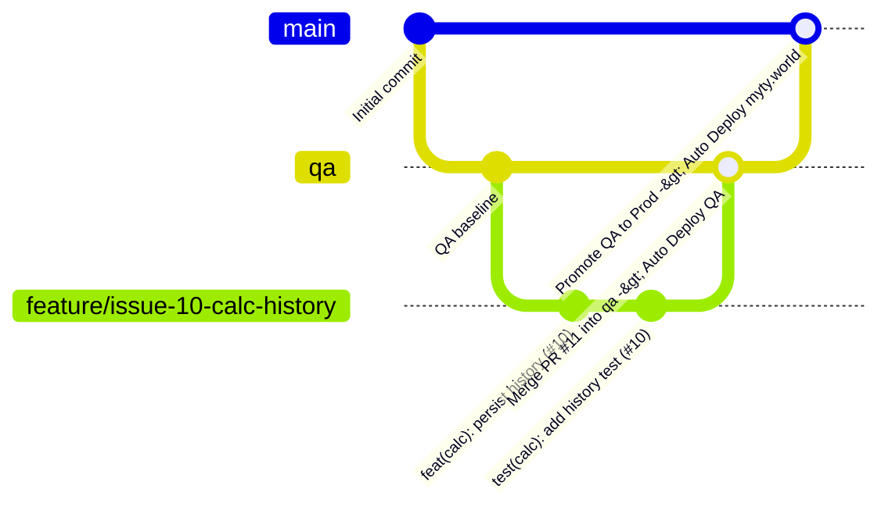

# Agile Development & Collaboration Workflow

> **Single Source of Truth for Team Processes, Issue Tracking, and Commit Standards**  
> **Repository:** [TairiJ/myty-hosting](https://github.com/TairiJ/myty-hosting)

---

## 1. Principles & Philosophy

We apply modern Agile software engineering best practices with an emphasis on **visibility, continuous integration, and rapid, safe iterations**:
1. **Atomic Issues:** Every unit of work must be captured as an independent, scoped issue with concrete acceptance criteria.
2. **Atomic Commits:** Every git commit must represent a single, reversible logical change with a descriptive Conventional Commit message.
3. **Continuous Verification:** Every commit and pull request triggers automated tests; code never reaches QA or Production without passing verification.
4. **Environment Promotion:** Code flows from feature branches into QA for live validation, and only after validation into Production.

---

## 2. Atomic Issues (The INVEST Standard)

Every GitHub issue created in this repository must satisfy the **INVEST** criteria:
- **I**ndependent: Can be developed, tested, and released without hard dependencies on other in-flight issues.
- **N**egotiable: Captures the user need and acceptance criteria without prematurely locking in rigid implementation details.
- **V**aluable: Delivers observable user, technical, or educational value.
- **E**stimable: Well-enough defined that effort and scope are clear.
- **S**mall: Sized to be completed in a few hours or a single pull request.
- **T**estable: Accompanied by unambiguous acceptance criteria that can be checked off.

### Issue Structure Template
```markdown
### User Story
As a **[type of user/persona]**,
I want **[specific capability or feature]**,
So that **[observable benefit or business value]**.

### Acceptance Criteria
- [ ] Criterion 1 (Observable behavior or test)
- [ ] Criterion 2 (Edge case or responsive requirement)
- [ ] Criterion 3 (Zero regressions in existing functionality)

### Definition of Done
- [ ] Automated validation test passes (`python -m unittest tests/test_website.py`)
- [ ] Container image builds and deploys to `https://qa.myty.world`
- [ ] Verified live in a browser
```

---

## 3. Atomic Commits Specification

### Why Atomic Commits?
- **Bisectability:** If a regression is discovered, `git bisect` can pinpoint the exact single-commit cause in seconds.
- **Reversibility:** An atomic commit can be cleanly reverted with `git revert <sha>` without collateral damage.
- **Code Review:** Reviewers can inspect focused, high-signal diffs rather than massive monolithic dumps.

### Conventional Commits Format
```text
<type>(<scope>): <short imperative description> [issue reference]

[optional body explaining motivation, context, and non-obvious details]
```

### Approved Types
| Type | Purpose | Example |
|---|---|---|
| `feat` | A new user-facing feature | `feat(calculator): add scientific degree-to-radian toggle (fixes #22)` |
| `fix` | A bug fix | `fix(keypad): prevent division by zero freeze (fixes #24)` |
| `docs` | Documentation only changes | `docs(readme): add environment promotion diagram (ref #25)` |
| `test` | Adding or correcting tests | `test(website): add assertion for meta viewport tag (fixes #28)` |
| `refactor` | Code change that neither fixes a bug nor adds a feature | `refactor(styles): consolidate color tokens into css variables (ref #30)` |
| `chore` | Build process, auxiliary tools, or dependency updates | `chore(ci): upgrade actions/checkout to v4 (fixes #31)` |

### Commit Rules
1. **Never combine unrelated work.** Do not fix a CSS bug and update documentation in the same commit.
2. **Use the imperative mood:** Write `"add feature"`, not `"added feature"` or `"adds feature"`.
3. **Reference the Issue:** Always suffix with `(fixes #<id>)` or `(ref #<id>)` to maintain GitHub issue traceability.

---

## 4. Branching & Environment Promotion Flow



### 1. Feature Branching
- Branch naming convention: `feature/issue-<number>-<short-description>` or `fix/issue-<number>-<short-description>`.
- Example: `feature/issue-15-memory-buttons`.

### 2. QA Deployment (`qa` branch)
- Open a Pull Request targeting `qa`.
- Once merged, GitHub Actions automatically executes `.github/workflows/deploy.yml`:
  - Runs validation tests.
  - Builds Docker image tagged `:qa`.
  - Pushes to GitHub Packages (`ghcr.io/tairij/myty-hosting:qa`).
  - Deploys container `site-qa` to Droplet via SSH.
  - Live inspection: **[https://qa.myty.world](https://qa.myty.world)**.

### 3. Production Promotion (`main` branch)
- After verification on QA, open a Pull Request from `qa` into `main`.
- Once merged, GitHub Actions automatically:
  - Runs validation tests.
  - Builds Docker image tagged `:latest`.
  - Pushes to GitHub Packages (`ghcr.io/tairij/myty-hosting:latest`).
  - Deploys container `site-prod` to Droplet via SSH.
  - Live inspection: **[https://myty.world](https://myty.world)**.

---

## 5. Definition of Done (DoD)

A user story or task is considered **Done** only when:
1. [ ] Code adheres to clean coding standards (HTML semantic markup, pure CSS tokens, vanilla JS modules).
2. [ ] All automated tests pass: `python -m unittest discover -s tests`.
3. [ ] Commits are atomic and adhere to Conventional Commits.
4. [ ] Deployed to and verified on `https://qa.myty.world`.
5. [ ] Approved and merged to `main`, successfully live on `https://myty.world`.
6. [ ] Related GitHub Issue is closed with a link to the deployed run.
