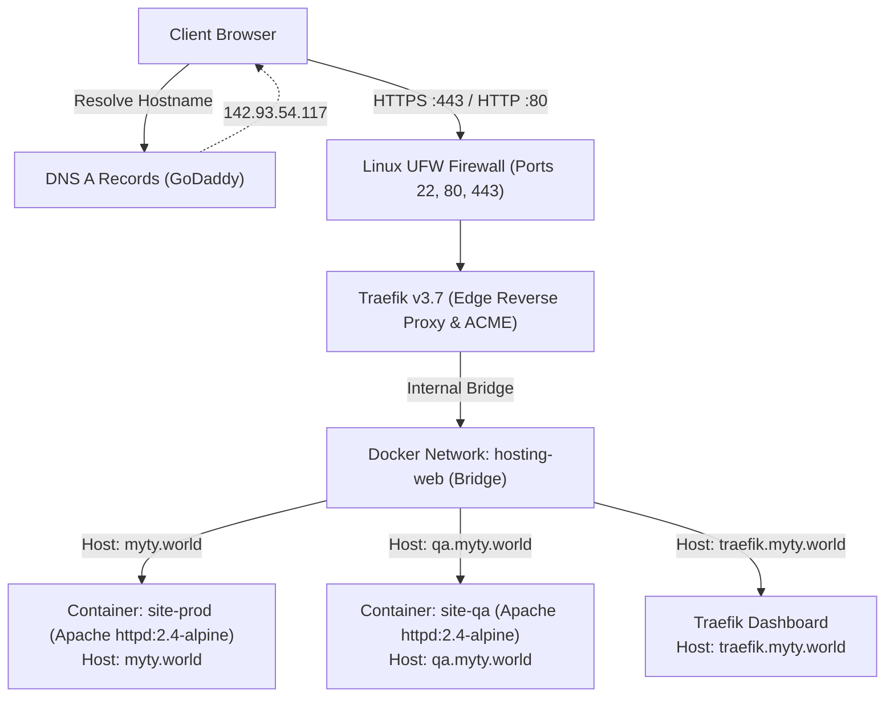

# System Architecture & Technical Specifications

> **Single Source of Truth for Network Topology, Container Orchestration, and Security**  
> **Repository:** [TairiJ/myty-hosting](https://github.com/TairiJ/myty-hosting)

---

## 1. System Topology Overview

The infrastructure runs on a single Ubuntu 24.04 LTS DigitalOcean Droplet (`142.93.54.117`) utilizing **Traefik v3.7** as an edge reverse proxy and container orchestrator with Docker.



---

## 2. Network & Ingress Routing

### Port Publication
- **Traefik** is the **only** service that binds to host ports:
  - Port `80`: Listens for HTTP traffic and automatically issues a `301 Moved Permanently` redirect to HTTPS (`entrypoints.web.http.redirections.entrypoint.to=websecure`).
  - Port `443`: Listens for TLS/HTTPS traffic and handles SSL termination.
- All application containers (`site-prod`, `site-qa`) do **not** publish host ports. They listen on internal port `80` connected strictly to the `hosting-web` Docker bridge network.

### Traefik Dynamic Discovery
Traefik reads container metadata via `/var/run/docker.sock` in read-only mode (`:ro`). Routing rules are declared directly on containers using Docker labels:

```yaml
labels:
  - "traefik.enable=true"
  - "traefik.http.routers.prod.rule=Host(`myty.world`)"
  - "traefik.http.routers.prod.entrypoints=websecure"
  - "traefik.http.routers.prod.tls.certresolver=letsencrypt"
  - "traefik.http.services.prod.loadbalancer.server.port=80"
```

---

## 3. Automated Certificate Management (ACME / Let's Encrypt)

- **Provider:** Let's Encrypt ACME v2.
- **Challenge Type:** HTTP-01 challenge via Traefik entrypoint `web`.
- **Storage:** Persisted in `/letsencrypt/acme.json` (permissions `0600`).
- **Renewal:** Fully automated; Traefik monitors certificate expiration and issues renewals 30 days prior to expiry without service interruption.

---

## 4. Container Specifications

### `Dockerfile`
The website container image is built from the official Alpine-based Apache image:
```dockerfile
FROM httpd:2.4-alpine
COPY src/ /usr/local/apache2/htdocs/
EXPOSE 80
```
- **Image Size:** ~55 MB (ultra-lightweight, minimal attack surface).
- **Base OS:** Alpine Linux with musl libc and BusyBox.
- **Web Server:** Apache HTTP Server (`httpd` 2.4.x).

---

## 5. Security & System Hardening

### SSH Hardening
To eliminate brute-force attack vectors and comply with rigorous DevOps security audits:
1. **Dedicated Non-Root User:** Administration and continuous deployment are performed by `deployer` (UID `1000`).
2. **Root SSH Login Disabled:** `PermitRootLogin no` is enforced globally in `/etc/ssh/sshd_config` and `/etc/ssh/sshd_config.d/99-security.conf`. Direct root login yields `Permission denied (publickey)`.
3. **Password Authentication Disabled:** `PasswordAuthentication no` and `KbdInteractiveAuthentication no` prevent dictionary and brute-force password attacks.
4. **Principle of Least Privilege:** `deployer` belongs to `sudo` and `docker` groups, allowing automated deployment without exposing root credentials.

### Firewall Configuration (UFW)
```text
Status: active
To                         Action      From
--                         ------      ----
22/tcp (OpenSSH)           ALLOW       Anywhere
80/tcp (HTTP)              ALLOW       Anywhere
443/tcp (HTTPS)            ALLOW       Anywhere
```
All other inbound ports are dropped by default.
